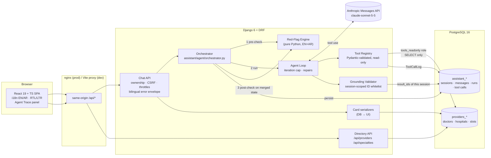
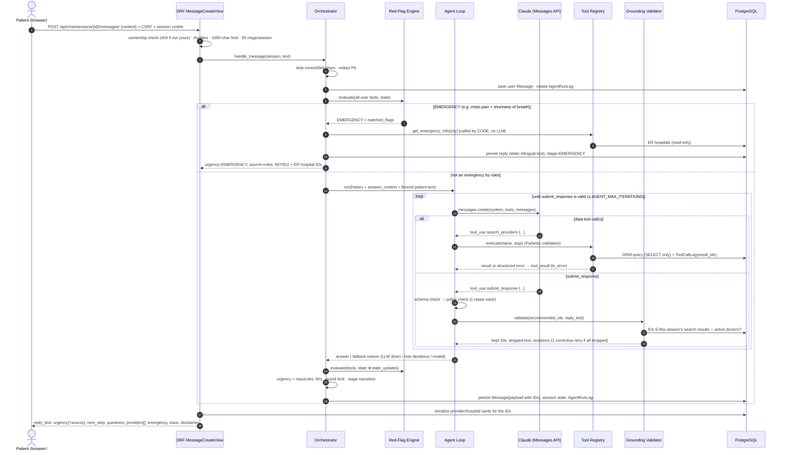

# Architecture

> **The LLM decides what to do. Deterministic code decides what is safe. The database decides what is true.**

## Components

| Layer | Responsibility | Key files |
|---|---|---|
| SPA | Chat UX, bilingual/RTL, quick replies, urgency banner, DB-rendered provider cards, trace panel, friendly errors with retry | `frontend/src/pages/Chat/ChatPage.tsx`, `frontend/src/components/chat/*`, `frontend/src/api/client.ts` |
| API | Validation (1000 chars), session ownership, CSRF (anonymous too), throttles, error envelope, OpenAPI | `backend/assistant/api/*` |
| Orchestrator | The only place a turn is decided: rules → loop → rules again → enforcement → persistence | `backend/assistant/agent/orchestrator.py` |
| Red-Flag Engine | Deterministic EN/AR emergency detection over text + structured state | `backend/assistant/safety/red_flags.py` |
| Agent loop | LLM ↔ tools, repair of invalid output, iteration cap | `backend/assistant/agent/loop.py` |
| Tools | Read-only, schema-validated directory queries; everything logged | `backend/assistant/tools/*` |
| Grounding | Recommended IDs must come from this session's search results; unverified names stripped | `backend/assistant/agent/grounding.py` |
| Stages / policy | Urgency floor, round limit, transitions (RECOMMEND requires grounded IDs) | `backend/assistant/agent/stages.py` |
| Cards | Provider/hospital facts serialized from DB rows, never LLM text | `backend/providers/serializers.py` |

## One message, end to end

## Data model

See [DATABASE.md](DATABASE.md) for the ERD. The key relationship is `ToolCallLog.result_ids`: it's what the model was actually shown, so it forms the whitelist of what the model is allowed to recommend.

## Failure handling at each boundary

| Boundary | Failure | Behaviour |
|---|---|---|
| Browser → API | offline / timeout (90 s) / 429 / 409 / 5xx / non-JSON proxy error | `ApiError.kind` → bilingual message, retry or "new conversation" button, 997 hint |
| API | invalid input, not owner, CSRF | `{"error": {code, message_en, message_ar}}` with 400/404/403 |
| Orchestrator → LLM | timeout, connection, 429, 5xx | tenacity exponential backoff (`LLM_MAX_RETRIES`, default 3), then safe fallback **with emergency numbers + ER list** |
| Orchestrator → LLM | 4xx / missing key / refusal | no retry, safe fallback |
| Loop | prose instead of tool / invalid schema / policy breach / all IDs invalid | one targeted correction each, then fallback (or deterministic enforcement) |
| Loop | runaway tool calling | hard cap `AGENT_MAX_ITERATIONS=5` → fallback |
| Tools | bad args / unknown tool / DB error | structured tool error to the model; logged; never raises |
| Anything unexpected | unhandled exception | logged with stack trace, generic bilingual 500 |

## Why these boundaries

- **Rules before and after the LLM.** Before, for availability and latency (an emergency doesn't wait on a model). After, because structured answers ("yes, it spreads to my arm" captured as a slot) can reveal an emergency the raw text didn't.
- **IDs, not names, cross the LLM boundary.** The model references `provider_id` values, and the UI renders DB rows. Fabrication is structurally impossible on the card surface, and reply text is scanned as a second line of defense.
- **One orchestrator.** Every turn, including the emergency short-circuit and fallbacks, ends in the same `_persist()`, so the audit trail (`AgentRunLog`, `ToolCallLog`) has no blind spots.
