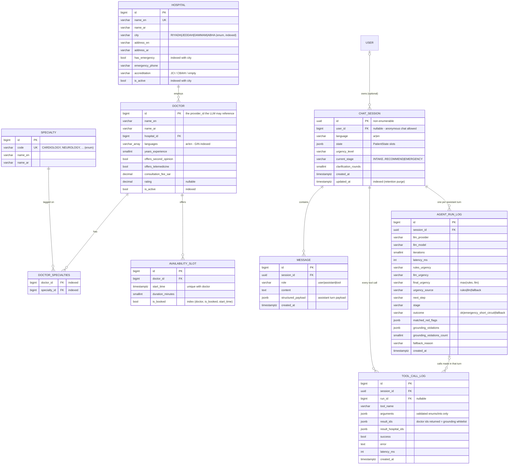

# Database structure

PostgreSQL 16. There are two Django apps:

- **`providers`** is the provider directory. It is read-only from the agent's point of view and is the only source of truth for doctors and hospitals.
- **`assistant`** holds the conversations and the audit trail: what the agent did, which tools it called, and which IDs those tools returned.

All provider data is **fictional** (`backend/providers/seed_data.py`).

## ERD

## Tables

| Table | Purpose | Notes |
|---|---|---|
| `providers_specialty` | Closed list of specialties | `code` mirrors the `SpecialtyCode` enum used in the tool schemas, so the LLM cannot search for a specialty that doesn't exist |
| `providers_hospital` | Hospitals and ERs | `has_emergency` + `emergency_phone` power the emergency path. Indexes: `(is_active, city)`, `(has_emergency, city)` |
| `providers_doctor` | Doctors (the *providers* the agent recommends) | `languages` is a Postgres `varchar[]` with a GIN index, so `languages @> '{ar}'` is index-backed. Unique `(name_en, hospital)` makes seeding idempotent |
| `providers_doctor_specialties` | M2M doctor↔specialty | Django indexes both FKs |
| `providers_availabilityslot` | Bookable 30-minute slots, next 14 days | Composite index `(doctor, is_booked, start_time)` answers "next free slots for doctor X" |
| `assistant_chatsession` | One conversation | `state` holds the validated `PatientState`. The UUID primary key can't be enumerated, and ownership is still checked separately (see SECURITY.md) |
| `assistant_message` | User and assistant turns | `structured_payload` stores the full assistant API payload, so history can be replayed exactly |
| `assistant_agentrunlog` | One row per assistant turn | Records urgency provenance (rules vs LLM), iterations, latency and grounding violations: the "why did it answer that" audit trail |
| `assistant_toolcalllog` | One row per tool execution | `result_ids` is the **grounding whitelist**: the model may only recommend doctor IDs that appear here for its own session |

## Seed coverage (fictional)

| City | ER hospital | Specialties available | Deliberate gaps |
|---|---|---|---|
| Riyadh | Al-Wahah Medical City | all 7 | (one inactive cardiologist, for grounding tests) |
| Jeddah | Red Sea Care Hospital | all except Gastroenterology | Gastroenterology |
| Dammam | Eastern Gulf Hospital | all except Pulmonology | Pulmonology |
| Abha | Asir Highlands Hospital | all except Neurology and Gastroenterology | **Neurology** (headline "not found" case) |

Seed with `python manage.py seed_providers`. The command is idempotent and runs automatically on `docker compose up`.
